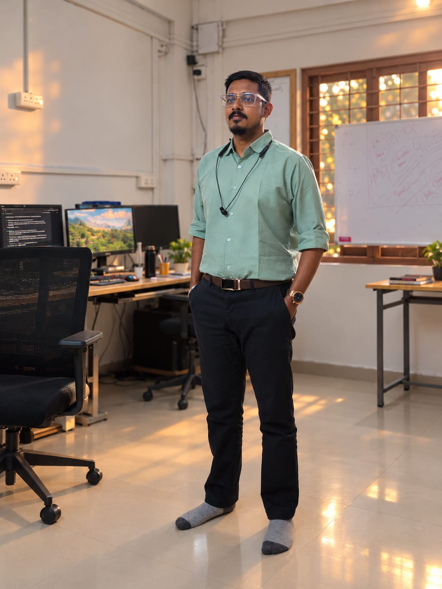
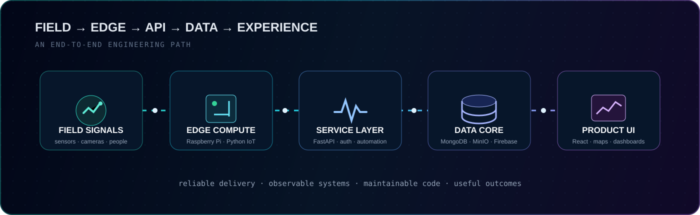
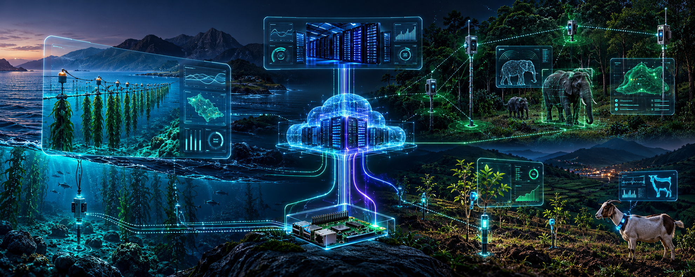
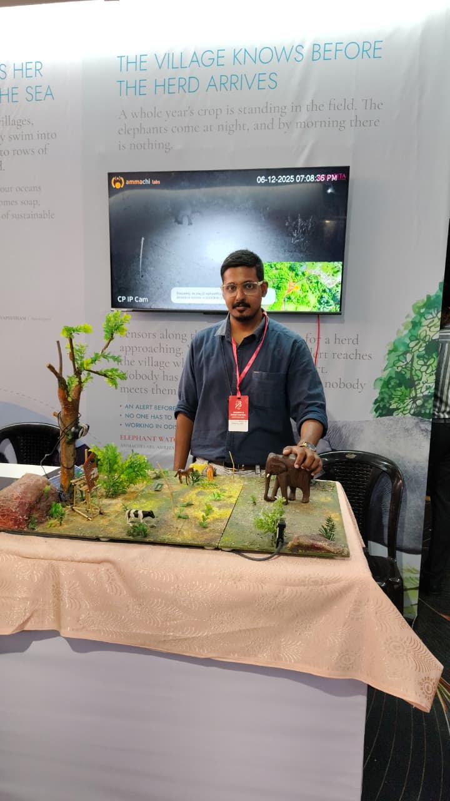

<div align="center">
  
</div>

<div align="center">

  

  [](https://github.com/curiousdevthinker)
  [](https://github.com/ruraltechammachilabs)
  [](#current-build)

</div>

## `01 / identity`

<table>
  <tr>
    <td width="32%" align="center">
      
    </td>
    <td width="68%">
      <h2>Engineer for the physical world.</h2>
      <p>I build software where <strong>field operations, IoT signals, data platforms, and product interfaces</strong> meet. My work covers rural technology, environmental monitoring, agricultural health, early-warning systems, geospatial workflows, and infrastructure.</p>
      <p>I move across the stack: understanding the field problem, shaping the data model, building APIs, designing dashboards, operating Linux systems, and making the final workflow useful.</p>
      <code>India</code> · <code>Rural Technologies</code> · <code>AMMACHI Labs</code>
    </td>
  </tr>
</table>

<div align="center">
  
</div>

## `02 / current-build`

<a id="current-build"></a>

<table>
  <tr>
    <td width="70%">
      <h2>Seaweed Aggregator</h2>
      <h4>Website + mobile app · actively building</h4>
      <p>A connected platform for seaweed cultivation aggregation, coastal field operations, livelihood workflows, reliable data collection, and coordinated service delivery.</p>
      <p><strong>Engineering focus</strong></p>
      <ul>
        <li>Clear workflows for field teams and operations</li>
        <li>Reliable APIs and structured domain data</li>
        <li>Responsive web and mobile experiences</li>
        <li>Practical observability and maintainable delivery</li>
      </ul>
    </td>
    <td width="30%" align="center">
      <br><br>
      <br>
      
    </td>
  </tr>
</table>

<div align="center">
  
</div>

## `03 / impact-systems`

<table>
  <tr>
    <td width="50%" valign="top">
      <h3>01 · Seaweed Aggregator</h3>
      <code>Website + App</code>
      <p>Coastal cultivation, aggregation, field operations, data collection, and livelihood workflows.</p>
    </td>
    <td width="50%" valign="top">
      <h3>02 · ElephantWatch</h3>
      <code>Website + App</code>
      <p>AI-assisted detection events, camera signals, community alerts, and rapid early-warning workflows.</p>
    </td>
  </tr>
  <tr>
    <td width="50%" valign="top">
      <h3>03 · Sapling Health Monitor</h3>
      <code>Website</code>
      <p>Geotagged sapling health, irrigation status, field observations, and monitoring dashboards.</p>
    </td>
    <td width="50%" valign="top">
      <h3>04 · Goat Monitoring</h3>
      <code>Website</code>
      <p>Livestock records, health observations, rural livelihood workflows, and program monitoring.</p>
    </td>
  </tr>
  <tr>
    <td width="50%" valign="top">
      <h3>05 · Data Center Monitoring</h3>
      <code>IoT Website</code>
      <p>A Raspberry Pi reads temperature, humidity, and smoke through connected IoT sensors, then sends the measurements to the monitoring website for live status and operational alerts.</p>
      <a href="https://github.com/ruraltechammachilabs/temperature-monitor-frontend">View repository →</a>
    </td>
    <td width="50%" valign="top">
      <h3>More engineering work</h3>
      <p><a href="https://github.com/ruraltechammachilabs/airanya_admin_server"><strong>AIranya</strong></a> — async image annotation and classification backend.</p>
      <p><a href="https://github.com/ruraltechammachilabs/coconuthealth_v2"><strong>Coconut Health</strong></a> — mapped agricultural health and field data experience.</p>
    </td>
  </tr>
</table>

<details>
  <summary><strong>ElephantWatch · field presentation</strong></summary>
  <br>
  <div align="center">
    
  </div>
</details>

## `04 / technology-grid`

<div align="center">

  

</div>

<table>
  <tr><td><strong>Product</strong></td><td>React · TypeScript · Vite · Redux Toolkit · Tailwind · Material UI · Leaflet</td></tr>
  <tr><td><strong>Services</strong></td><td>Python · FastAPI · REST APIs · JWT · Firebase Admin · Pydantic</td></tr>
  <tr><td><strong>Data</strong></td><td>MongoDB · MinIO · Firebase · object storage · structured field data</td></tr>
  <tr><td><strong>Edge & IoT</strong></td><td>Raspberry Pi · Python IoT · temperature, humidity, and smoke sensors · live telemetry · event monitoring</td></tr>
  <tr><td><strong>Infrastructure</strong></td><td>Linux server management · networking · file management · remote development · cloud infrastructure · Docker</td></tr>
</table>

## `05 / github-telemetry`

<div align="center">
  
  
</div>

<div align="center">
  
  
</div>

<div align="center">
  
</div>

```text
signal → understand → design → build → observe → improve
```

<div align="center">
  <sub>Engineering reliable digital systems for measurable real-world impact.</sub>
</div>
