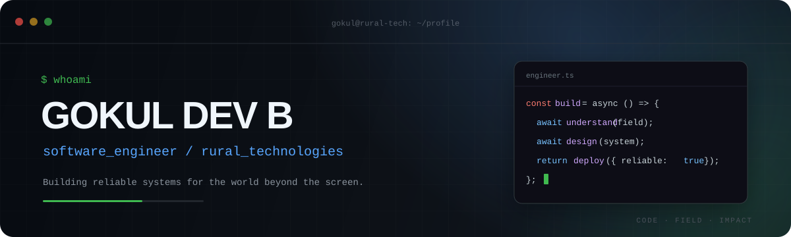

<div align="center">
  
</div>

<div align="center">

[](https://github.com/curiousdevthinker)
[](https://github.com/ruraltechammachilabs)
[](https://ammachilabs.org/rural-participatory-design/)

</div>

```ts
const engineer = {
  name: "Gokul Dev B",
  role: "Software Engineer",
  team: "Rural Technologies · AMMACHI Labs",
  mission: "Build reliable software for real-world impact",
  domains: ["rural tech", "agritech", "monitoring", "applied AI"],
  status: "shipping useful systems"
};
```

## `~/about`

I build software that connects **field reality with digital systems**. My work spans real-time monitoring, agricultural health, image annotation, geospatial field data, early-alert systems, and rural livelihood platforms.

I enjoy owning the path from interface to API: shaping the data, building the workflow, handling failure states, and making the final system understandable to the people using it.

```text
$ current_focus
> resilient dashboards · async APIs · field data · useful automation

$ engineering_values
> clarity · reliability · maintainability · measurable impact
```

## `~/stack --list`

### Languages


### Frontend


### Backend & Data


### Tools


## `~/projects --featured`

### `01 // Data Center Monitoring System`

> A real-time operations dashboard for temperature, humidity, smoke, system status, users, and alert recipients.

My contributions include data visualizations, Firebase integration, authentication flows, alert-user operations, offline detection, validation rules, UI improvements, documentation, and configuration security.

`React` `Firebase` `Redux Toolkit` `Material UI` `ApexCharts` `i18n`

**[view repository →](https://github.com/ruraltechammachilabs/temperature-monitor-frontend)**

---

### `02 // AIranya`

> An async backend for rural image-classification and annotation workflows.

Supports projects, datasets, categories, images, assignments, annotations, roles, statistics, and authentication, with an architecture ready for object-storage integration.

`Python` `FastAPI` `MongoDB` `Motor` `Pydantic` `JWT` `Firebase Admin` `Docker`

**[view repository →](https://github.com/ruraltechammachilabs/airanya_admin_server)**

---

### `03 // Coconut Health Dashboard`

> A responsive field dashboard for coconut-health data, mapped observations, and service-backed agricultural views.

`React` `TypeScript` `Tailwing CSS` `Leaflet` `Axios` `GSAP`

**[view repository →](https://github.com/ruraltechammachilabs/coconuthealth_v2)**

## `~/field-systems --more`

```yaml
seaweed_aggregator:
  components: [backend, web platform]
  purpose: cultivation aggregation and livelihood workflows

elephant_watch:
  component: backend
  purpose: AI-assisted detection events and rapid field alerts

sapling_health:
  purpose: geotagged plant-health and irrigation monitoring

goat:
  purpose: field workflows for livestock and rural livelihood programs
```

## `~/github --telemetry`

<div align="center">
  
  
</div>

<div align="center">
  
</div>

```text
while (curious) {
  learn();
  build();
  deploy();
  improve();
}
```

<div align="center">
  <sub>Built with code, field context, and a bias toward useful things.</sub>
</div>
